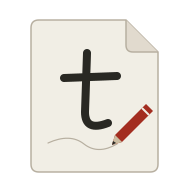
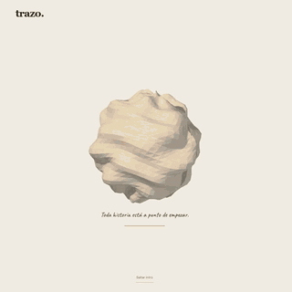

<p align="center">
  
</p>

<h1 align="center">Trazo</h1>

<p align="center">Every story begins with a line.</p>

<p align="center">
  A bilingual journey through the history of drawing, from cave walls to digital screens.<br />
  Follow a little stickman as pencil illustrations come to life with your scroll.
</p>

<p align="center">
  <a href="https://oscartired.github.io/Trazo/"><strong>Explore the experience</strong></a>
</p>

<p align="center">
  
  
  
  
  
  
  <a href="LICENSE"></a>
</p>

<p align="center">
  <a href="https://oscartired.github.io/Trazo/media/trazo-showcase.mp4">
    
  </a>
</p>

<p align="center">
  <a href="https://oscartired.github.io/Trazo/media/trazo-showcase.mp4">Watch or download the complete 25-second video</a>
</p>

## The experience

- Six chapters trace the history of drawing through original pencil illustrations revealed by scroll-driven hatching masks.
- An articulated stickman follows a continuous thread and introduces each era.
- A real 3D paper intro unfolds, crumples and gives way to the story. Skip or replay it at any time.
- Full Spanish and English support, with a persistent language preference.
- Smooth scrolling with Lenis and GSAP ScrollTrigger, with cached geometry and animation frames active only while needed.
- An interactive drawing sheet supports mouse, touch and pen input, two pencil colors, erasing and PNG export. Keyboard users can add a line using a dedicated control.
- Responsive layouts and automatic or manual reduced motion support. Illustrations remain fully visible with reduced motion.

## Run locally

Use Node.js 24 or newer and pnpm 11.1.2.

```sh
git clone https://github.com/OscarTired/Trazo.git
cd Trazo
pnpm install --frozen-lockfile
pnpm dev
```

Open `http://localhost:5173/`.

```sh
pnpm build
pnpm preview
```

The production build is generated in `dist/`. Preview it at `http://localhost:4173/Trazo/`. Three.js is loaded separately for the intro and is skipped when reduced motion is enabled.

## GitHub Pages

The site is deployed to **https://oscartired.github.io/Trazo/** by [GitHub Actions](.github/workflows/deploy.yml) on every push to `main`. The workflow installs dependencies from the lockfile, builds the site and publishes `dist/`.

Vite uses `/` during development and `/Trazo/` for production builds and previews. Runtime image and texture URLs use `import.meta.env.BASE_URL`. To host the project under another repository name or a custom domain, update `base` in [vite.config.ts](vite.config.ts).

## Verification

With the development server running on port 5173:

```sh
pnpm verify
node scripts/verify-motion.mjs
```

To check the production build under its GitHub Pages path, run `pnpm preview` after building, then:

```sh
pnpm verify:pages
```

The browser checks use Playwright and a locally installed Chrome. Set `CHROME_PATH` when Chrome is outside its standard Windows location. Reports and screenshots are written to `.impeccable/review/` and are excluded from Git.

Use `?lang=en` to start in English or `?review=1` to skip the intro while inspecting the content. Section links such as `#modern` preserve their destination after the intro.

## Project structure

```text
src/                    Story, translations, drawing and animation logic
public/assets/          Original artwork, paper texture and optimized WebP assets
public/trazo-mark.svg   Project mark used in this README
scripts/                Browser checks and performance measurements
public/media/          Finished showcase video
docs/media/            Animated README preview
.github/workflows/      GitHub Pages deployment
SOURCES.md              Historical references
```

## Credits and license

Created by [OscarTired](https://github.com/OscarTired). Historical references are listed in [SOURCES.md](SOURCES.md). Illustrations are artistic interpretations rather than documentary reproductions. Fonts are served locally through Fontsource.

Project code and original assets are available under the [MIT License](LICENSE). Third-party libraries and fonts retain their respective licenses; their notices are included in [public/licenses](public/licenses).
